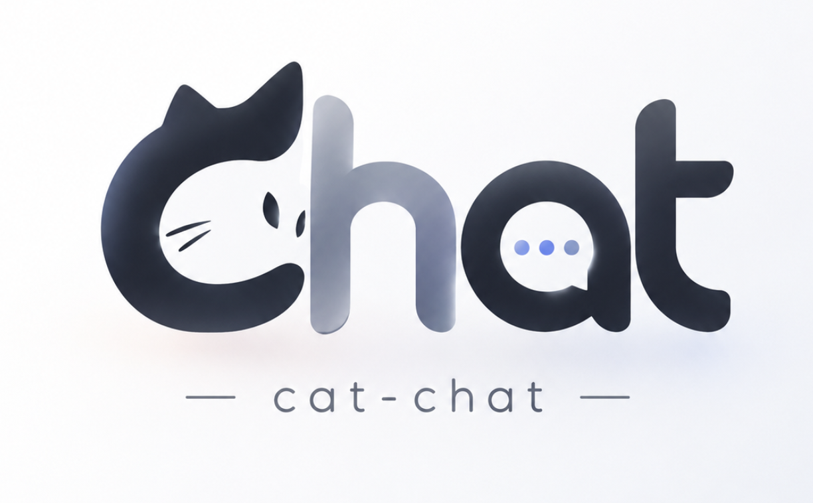

# Cat Chat 3.9.4 Beta

<p align="center">
  
</p>

Cat Chat 是运行在 Windows 本机的通用 AI 自动化工作台。它把在线或本地模型、内置工具、后台任务、Skill、MCP、视觉工具和文件产物统一到一个对话界面中。3.9.4 Beta 给创作场分镜生图补上模板系统提示词：提词库中间栏一键「发送到分镜生图」导入模板，面板写法编辑框支持手动修改、即时保存与恢复默认。

> Cat Chat 原名 Naiba Chat。显示名自 2.7.6 Beta 起为 Cat Chat；GitHub 仓库自 2.8.0 Beta 起更名为 `cat-chat`（旧地址自动跳转）。更新资产仍使用 `naiba-chat.exe` 与原有清单协议，既有数据位置不变，无需重新配置或搬迁数据。

## 3.9.4 Beta 主要能力
- ****提词库一键导入****：在提词库选中模板，中间栏新增「发送到分镜生图」按钮，点一下就把模板正文作为分镜生图的写法（系统提示词）带过去，并自动切到创作场的分镜阶段；自定义模板以编辑框现值为准。
- ****分镜面板可手动编辑****：分镜阶段新增「出图提示词写法（系统提示词）」编辑框：留空用内置分镜写法；手动改或导入模板后立即保存（跨会话保留），「恢复默认写法」一键清空。
- ****写法走系统提示词、格式有保底****：自定义写法与内置写法都作为系统提示词发送，不混进正文消息；正文始终保留「每场一块、【第 N 场】开头」的输出格式要求，换任何模板都能按场拆分并交接造梦机；写法超 8000 字截断并明示。
- ****要素反哺与重试照旧****：已保存要素的人物、场景、道具参考拼在写法之后；写法随任务快照落盘，重试原样重放；右栏写明本次用自定义写法还是内置写法。
- ****验证****：全量单测 **3415** 通过；创作场隔离实例冒烟 **191** 项全过（写法编辑、随提交发送、恢复默认、提词库导入全链路）；48 张视口截图无横向溢出。
> 历史版本说明见 [CHANGELOG.md](CHANGELOG.md)。

## 开始使用

### 使用 Windows 版本

1. 下载 `cat-chat-3.9.4-beta-windows-x64.zip`。
2. 解压到一个可写目录。
3. 运行 `cat-chat.exe`。
4. 在设置中添加在线 API 或本地模型服务。

> 归档里也提供旧名 `naiba-chat-3.9.4-beta-windows-x64.zip`（内含 `naiba-chat.exe`）——**两者内容等价，只是包内 exe 的文件名不同**，任选其一即可。安装后的文件名由你首次解压的那个决定，之后自动更新会一直沿用，不会中途改名。

首次运行会创建本地数据目录。升级时请直接替换程序文件，不要删除原有 `data` 目录和配置文件。

### 从源码运行

需要 Windows、Python 3.11 或更高版本。

```powershell
git clone https://github.com/yc883123/cat-chat.git
Set-Location cat-chat
python -m pip install pywebview pystray pillow "mcp==2.1.1" pymupdf "av==18.1.0" python-multipart
python server.py
```

服务默认地址为 `http://127.0.0.1:8765`。

## 模型配置

在“设置 → 模型”中添加供应商，填写：

- API 地址
- API Key（本地服务通常可以留空）
- 模型名称
- 请求格式
- 是否支持图片输入
- 上下文长度和生成参数

本地模型建议先使用界面中的连接测试确认模型目录、文本推理和图片能力。模型是否能稳定执行工具，仍取决于模型自身的工具调用能力和上下文能力。

## ComfyUI 与 MCP

Cat Chat 默认连接：

```text
ComfyUI HTTP API:  http://127.0.0.1:8188
```

使用前请确保 ComfyUI 已启动，并且目标节点、模型和素材在 ComfyUI 中可用。

当前内置流程接收 ComfyUI **API 工作流**。前端保存的 UI JSON（通常包含 `nodes` 和 `links`）不能直接提交，需要先在 ComfyUI 中导出 API 格式。

任务提交后由宿主完成以下工作：

1. 校验并规范化工作流参数。
2. 向 `/prompt` 提交任务。
3. 轮询任务历史和执行状态。
4. 自动收集图片、视频或音频产物，缓存到受管理数据目录并生成缩略图。
5. 附加到最终消息（中止/取消的轮次也会展示已生成的产物）。
6. 在聊天界面提供预览或下载。

推荐的工作流修改方式：对已有工作流文件，用 `read_file`/`comfyui_prepare_workflow` 读取结构，用 `edit_file` 做局部精确替换（改提示词/seed/尺寸等），再用 `comfyui_batch` 的 `workflow_paths` 提交文件路径；不要整段内联大工作流 JSON。

这条链路不要求模型读取产物本身。需要评价画面、OCR、定位对象或比较图片时，用户应明确提出分析要求；用户明确要求「保存/复制到指定目录」时模型会实际执行。

### MCP 说明

- 应用启动时自动连接所有已启用的 MCP 服务，并对启动时未连上的服务做周期重试。
- MCP 工具以 `mcp__<server>__<tool>` 形式注册进当前会话的可用工具集；会话工具集在首条消息时固化。
- `call_mcp(server, tool, arguments)` 只能调用**当前会话可用集内**的 MCP 工具；若目标工具不在可用集内，会提示用户重开会话、在 Agent 工具勾选里加上该 MCP 服务后再用。
- `register_mcp` 只是把服务登记进配置，其工具会在**重开会话后**进入新会话的可用集，本会话内不会因注册而新增可用工具。

## 工具、Skill 与 MCP 的关系

- **内置工具**：由当前任务意图直接触发，例如文件操作、命令执行、后台任务、ComfyUI 和视觉处理。
- **Skill**：提供特定领域的说明、模板、脚本和检查清单，不决定工具是否可用。
- **MCP**：接入外部工具服务；只有任务明确需要对应 MCP 服务时才会连接或调用。

因此，生成图片不需要先启动短剧 Skill，普通编程、资料整理、自动化处理和媒体任务也使用同一套运行机制。

## 数据与安全

- 对话、设置、附件和任务状态保存在本地数据目录。
- 缓存文件（用户上传与宿主产物的图片/PDF/视频/音频等）统一存于受管数据目录（用户上传 `data/uploads`、生成产物 `data/generated`），设置页可**分别**查看两者大小与合计、**按目录**手动清理旧缓存（会按时间从旧到新删除最旧文件，但被消息、快照、聊天背景引用的文件一律保留），并**分别**配置两个自动清理阈值（上传缓存默认 256MB、生成产物缓存默认 512MB；两者各删各的、互不挤占额度）。
- API Key 不应提交到 Git；示例配置不包含真实凭据。
- 局域网访问需要访问口令，默认仅本机访问时不要求口令。
- 文件预览只允许应用工作区和受管理数据目录（`data/uploads`、`data/generated`）中的文件。
- 高风险写入、删除、外部发布和凭据操作仍受权限策略保护。

## 皮肤素材授权

18 张模型角色皮肤（`public/skins/*.webp`）由 B 站作者 **ZipZipPipe** 创作，经作者授权在本项目中使用。

- 作者主页：<https://b23.tv/7GqH3VL>
- **授权范围仅限非商业用途。严禁将本项目或其中皮肤素材用于任何商业用途**（包括但不限于付费分发、商业产品内置、以营利为目的的内容生产与二次贩卖）。
- 皮肤素材的著作权归原作者所有。本项目仅获得在上述范围内的使用权，不转让、不授权任何第三方商业使用。
- 如需商业使用，请自行联系原作者取得书面许可。

## 免责声明

本项目（Cat Chat）为开源、免费、非商业的本地工具，按「现状」提供，不附带任何明示或默示担保。请在使用前完整阅读以下内容：

- **使用者应对自己的全部操作与产出负完全责任。** 你使用本软件生成、处理、发布、传播的任何内容及其后果，均由你本人承担。
- **因使用者使用本软件而产生的任何违法违规行为，与本软件作者无关。** 作者不参与、不知情、不认可、也不承担任何连带责任。这包括但不限于：违反所在地法律法规、侵犯他人知识产权或隐私、生成或传播违法有害信息、未经授权访问或修改他人系统与数据、侵犯商业秘密等。
- 本软件只是本地运行的工具，不提供任何模型、算力或第三方服务；模型输出的内容由对应模型服务方与使用者共同决定，作者无法控制也无法预知其结果。
- 使用者应自行确保：所使用的模型服务、账号、密钥、素材与数据来源合法合规，且已取得必要授权；对重要数据自行备份。
- 在适用法律允许的最大范围内，作者不对因使用或无法使用本软件造成的任何直接、间接、附带、特殊或后果性损失承担责任（包括数据丢失、业务中断、利润损失等）。
- 如你不同意上述任何一条，请勿使用本软件。

## 自动更新校验

发布资产包含：

- `naiba-chat.exe` —— **自动更新链路唯一使用的资产，永久保留此文件名**
- `naiba-chat-update.json` —— 更新清单，其中 `repository` 字段永久写 `yc883123/naiba-chat`
- `cat-chat.exe` —— 与 `naiba-chat.exe` 是同一文件，SHA-256 完全相同
- `cat-chat-3.9.4-beta-windows-x64.zip`
- `naiba-chat-3.9.4-beta-windows-x64.zip` —— 与上一个内容等价，仅包内 exe 名不同

更新器会验证清单中的仓库、提交、文件名和 SHA-256。下载文件还必须是有效的 Windows 可执行文件；任何一项不一致都会终止安装。**自动更新始终读取 `naiba-chat.exe` 与清单里的旧仓库名**（GitHub 对旧仓库地址做长期重定向），这是已发布客户端逐字校验的协议，仓库改名后也不改值。

## Beta 说明

这是 3.9.4 Beta，适合实际使用和反馈，但仍有以下边界：

- 不内置 ComfyUI、模型权重或第三方生成服务，需用户自行安装和配置。
- 不同模型的工具调用质量差异较大，小型模型可能无法稳定完成长链任务。
- ComfyUI 自定义节点和工作流输入差异很大，复杂模板仍可能需要一次参数适配。
- 自动化任务应在交付前检查最终文件；涉及发布、删除或覆盖的重要操作应保留备份。
- MCP 工具仅在重开会话后才会进入会话可用集；若模型发现 MCP 服务存在但其工具不在当前会话可用范围，会提示用户重开会话。
- 视频抽帧依赖 PyAV（打包版已内置随附的 FFmpeg 运行库）；从源码运行时需要 `pip install av`，缺失时工具会明确提示安装而不是直接崩溃。

## 测试与构建

```powershell
Get-ChildItem public\js\*.js | ForEach-Object { node --check $_.FullName }
python -m unittest discover -s tests -q
$env:NAIBA_BUILD_VERSION = "3.9.4-beta"
python -m PyInstaller --noconfirm --clean naiba-chat.spec
```

静态检查器、浏览器冒烟与数据播种脚本**随仓库发布**在 `verify/`（完整清单与用法见 `项目维护说明（修改代码前必读）.md` §六）：

```powershell
python verify\scan_undef_all.py        # 未定义名扫描（Python 全包）
python verify\esm_graph_check.py       # 前端 ESM 导入/导出图一致性
python verify\tdz_check.py             # 前端顶层求值序（TDZ）候选
node verify\media_markup_check.mjs     # 媒体渲染（无浏览器）
$env:NODE_PATH="%USERPROFILE%\node_modules"
node verify\browser_smoke.cjs          # 浏览器冒烟（需 playwright + Edge）
python verify\ring_usage_smoke.py      # 上下文圆环/提醒端到端冒烟（自编排）
```

浏览器冒烟需要本机 `npm install playwright` 并已安装 Edge；脚本一律用相对项目根的路径，换机器无需改代码。

## 项目地址

- GitHub：<https://github.com/yc883123/cat-chat>（原名 <https://github.com/yc883123/naiba-chat>，旧地址自动跳转）
- Issues：<https://github.com/yc883123/cat-chat/issues>