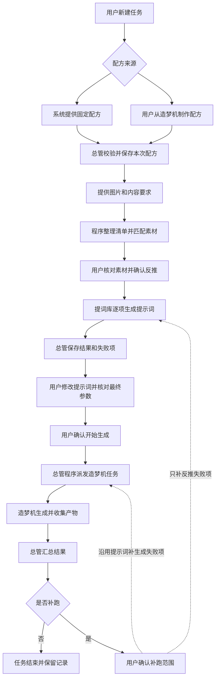

# 任务总管配方预设与造梦机执行计划

日期：2026-11-02
状态：用户已于 2026-11-02 要求执行，实施中，尚未完成最终验收。
执行补充：固定工作流采用 ComfyUI 官方 MiniMax H3 图生视频、参考生视频两类，提示词参考 shortdrama 与 H3 prompt writing。本文保留原评审稿以追溯要求；其中“本次仅文档/未经授权不开发”的历史描述不再限制本轮已授权实施。真实模型或生成服务调用、付费、提交、推送和发布仍未授权。实际覆盖及验证见[实施验收](2026-11-02-任务总管配方预设实施验收.md)。

> 本计划是现有任务总管的一项有界功能设计，**不是 Super Agent V2 实施计划**，不启动、不承诺完成 V2。它讨论如何降低新建任务的操作成本，以及如何在少用模型、少用 Token 的前提下，协调提词库和造梦机。文中的实体、接口与界面均为拟议方案，不代表已经实现。

## 一、问题和目标

当前新建任务要求用户理解任务类型、阶段与参数，再手工配置执行关系。用户希望通过预设完成“提供图片 → 反推提示词 → 运行工作流 → 收取结果”，不再逐条复制和提交。

目标是：

1. 普通用户选配方、提供素材，不必手写任务节点。
2. 已经在造梦机调好工作流的用户，可将明确的参数配置交给总管重复执行。
3. 提词库承担反推与提示词生成，造梦机承担实际生成，总管承担组织、确认、调度和恢复。
4. 流程确定后由程序推进，不让模型反复规划、读取历史和判断下一步。
5. 保存中间结果，视频失败不重新反推，下载失败不重新生成。

本计划不以“增加一个独立工作台模块”替代任务总管，也不加入无限画布。

## 二、已经明确与尚待决定

### 2.1 已经明确的方向

- 不做无限画布。
- 优先省钱、省 Token，不建设持续调用模型的自主循环。
- 讨论固定工作流预设和用户自定义配方两条入口。
- 素材由用户提供，提示词可通过提词库反推，最终由造梦机执行。
- 本次只写文档供评审，不开始开发，不实施 Super Agent V2。

### 2.2 本文的推荐，不等于用户已经拍板

- 两条入口共用一份配方契约；首个交付先验证一个固定配方。
- 首期按“一项素材/片段对应一份提示词和一个造梦机任务”组织，暂不自动扩展分镜。
- 默认先审核反推结果，再单独确认最终生成。
- 默认串行派发，成功项复用，失败阶段由用户选择补跑。

素材组织方式、首个工作流及反推模板尚未选定，见第十四节。不能在未确认这些问题时把本文直接当成开工指令。

## 三、任务总管和各模块的边界

| 组件 | 负责 | 不负责 |
|---|---|---|
| 任务总管 | 接收预设、收集输入、持久清单、等待确认、调用执行域、汇总进度、恢复对账 | 自己实现视觉反推、ComfyUI 执行或反复询问模型下一步 |
| 提词库 | 模板加载、变量填充、带图模型请求、反推结果和原生任务 | 猜测工作流中每个参数的业务用途 |
| 造梦机 | 工作流库、参数与媒体校验、上传、生成、产物收集、检查点续跑 | 自主编写剧情或替用户确认批次 |
| 对话/Agent 能力 | 只有需要理解自由目标、创作剧情或复杂拆分时才调用 | 固定预设运行的必经中转站 |

用户可以始终在任务总管完成本次任务，不必手工跳到聊天拆解再复制回来。内部通过已有服务调用，不通过模型模拟点击其他页面。

## 四、两种入口，共用执行流程

### 4.1 方案一：系统提供固定配方

系统随配方提供：

- 已验证的工作流及版本/指纹；
- 明确的文本、图片和可调数值输入；
- 业务名称及素材角色，例如“主角参考图”“场景参考图”；
- 提词库模板及结果选择规则；
- 固定参数、逐项参数、次数、完成判据及可用恢复动作。

用户只填写素材与内容要求，不接触节点 ID。工作流发生变化后先校验，失配则停止，不静默迁移到名称相似的节点。

### 4.2 方案二：用户从造梦机制作用于总管的配方

用户在造梦机选择“交给任务总管”，明确指定：

1. 哪些参数保持当前值不变；
2. 哪个文本参数接收每项提示词；
3. 哪些媒体入口逐项变化，哪些是整个任务共用素材；
4. 每个媒体入口的业务用途，例如角色、场景、首帧，而不仅是“图1”；
5. 提词库模板、可选补充要求及次数。

总管接收的是经过校验的配方快照，不是对表单截图进行推理，也不是对任意工作流进行自主接管。首次配置可保存复用；下次核对变化，不必重复询问所有参数。

首期只支持造梦机已识别且已验证的槽位，不承诺任意 ComfyUI 节点均可管理。

### 4.3 节点信息的用途

| 信息 | 用途 | 限制 |
|---|---|---|
| 工作流 ID/指纹 + 节点 ID + 字段名 | 标识真正写入的位置 | 工作流变化必须重新校验 |
| `object_info` | 校验输入类型、枚举、连接等约束 | 不理解角色、场景、首帧等业务含义 |
| 节点名称/标题 | 帮助用户识别和显示说明 | 不作为唯一身份，不凭名称自动绑定 |
| 用户/系统配方中的业务角色 | 说明素材如何使用 | 必须显式定义，不能靠模型默认猜测 |

两种入口区别在于谁承担首次配置责任，不在于采用两套调度系统。

## 五、拟议流程图

反推确认不包含生成授权。生成确认绑定最终清单，不因“按顺序继续”而绕过。

## 六、省钱与省 Token 的执行规则

### 6.1 不调用模型的操作

文件扫描、自然排序、确定性分组、已有规则匹配、类型校验、填参、入队、轮询、状态统计、落盘、产物关联和检查点恢复均由程序完成。

固定流程不额外创建聊天规划轮次，不把所有任务日志回灌模型，不用模型判断原生任务是否成功。

### 6.2 真正需要模型的操作

默认只在提词库处理图片和编写提示词时调用选定模型。

对已经按片段准备的图片，优先“图片 + 提词库模板 + 内容要求 → 一次输出可用生成提示词”，不强制先通用识图，再通过聊天改写。

若用户已有提示词，可允许跳过反推；这是省模型成本的可选能力，不改变当前以图片反推为主的场景。

### 6.3 缓存与费用口径

- 同一任务的成功结果以明确输入版本复用；图片、模板、变量、模型或补充要求变化后不能误用旧结果。
- 生成失败沿用已确认提示词，不重新调用反推模型。
- 产物下载失败优先补下载，不重新生成。
- 首期不做跨用户或不透明的全局语义缓存。
- 展示反推项目数和生成总次数；价格未知时说明以供应商为准，不虚构估价。
- 不承诺“一图一次请求必定最便宜”；图片编码、模型计价与模板长度均影响费用。一图一项首先服务于可追踪和精确补跑，优化需另做小样本验证。
- 不静默切换备用供应商；切换可能改变费用、隐私范围和输出质量，需要用户明确选择。

## 七、素材与短剧内容的边界

必须区分两类素材：

1. **片段/分镜已经准备好**：每项有图片和对应内容，系统反推或编写动态提示词后生成。适合作为首期有界配方。
2. **只有角色图、场景图**：还需要剧情、分段、角色分配及片段衔接。仅反推图片不能完成连贯短剧，不纳入默认能力承诺。

建议首期不自动补全剧情。没有对应内容时让用户补充，不能偷偷新增多轮创作调用。

素材规则：

- 文件夹保留相对路径和稳定项目 ID；同名不同目录、同内容不同来源不能被错误合并。
- 一个图片入口是公共素材还是逐项素材，由配方确定。
- 同名匹配和子目录匹配只能在有明确定义的规则下进行；歧义进入待核对，不凭文件排序暗配图1/图2。
- 优先复用已有目录选择/上传能力，区分客户端目录和服务端本机路径。
- 目录读取权限与媒体上传是不同授权；导入前说明读取范围，发给供应商前说明外发范围。
- 媒体进入受管目录并建立快照，不将任意本机路径直接传给造梦机。
- 来源原件和反推处理副本可追溯，生成需要原件时不能误用缩略图；活动引用纳入清理保护。
- 超限、损坏图片、格式不支持和路径越界必须可见，不静默丢项；批次数量和体积上限在契约阶段明确。

## 八、结果选择、参数绑定与确认

### 8.1 提词库输出不能直接假定为单条提示词

模板可能输出解释、JSON、多段文本或多个分镜。配方需要声明结果选择方式：已验证的单文本输出、严格 JSON 字段，或用户选择/编辑。

解析失败、多结果或超长时进入待核对，不默认取第一段，不静默截断，不再隐藏调用模型“猜正确答案”。

首期建议选用已验证的单结果模板；用户可套用提词库已有模板或选择已导入的自定义模板，但不能承诺任何模板都能自动解析。

### 8.2 工作流参数绑定

由配方指定文本目标与可选媒体目标。不得因为参数叫 `positive`、`prompt` 或只有一个文本框就自动选中。

文本类型并不保证用途安全。只允许已经验证的提示词字段，不把模型输出写入凭据、代码、表达式或路径参数。

固定值、公共值与逐项覆盖的优先级必须清楚；出现冲突时展示并解决，不覆盖用户原有造梦机草稿，也不修改工作流库原件。

### 8.3 两道确认

| 确认 | 用户看见的内容 | 授权范围 |
|---|---|---|
| 开始反推 | 素材范围、模板、供应商/模型、请求项数 | 本批次确定图片的反推，不包含视频生成 |
| 开始生成 | 逐项提示词、素材映射、工作流、最终参数、纳入范围、总次数及执行目标 | 这份确定快照的生成，不包含后续改稿和追加次数 |

在最终生成审核中同时明确确认参数绑定；不强制另设一道同义弹窗。若提供单独“仅保存参数”操作，则不得因此开始生成。

修改素材、提示词、工作流、关键参数或数量后，受影响的未执行项需要重新确认。失败项可明确排除后执行剩余项，不能静默跳过并报全部成功。

## 九、持久化和执行契约

建议增加以下有界实体，名称和存储细节在实施前冻结：

| 实体 | 保存内容 |
|---|---|
| 配方 | 来源、版本、工作流指纹、槽位映射、输入角色、模板及结果规则 |
| 任务清单 | owner、关联总管任务、revision、公共参数、纳入范围、确认摘要 |
| 清单项目 | 稳定 ID、来源相对路径、素材引用、提示词版本、参数快照、阶段状态 |
| 执行关联 | 项目/阶段/attempt、请求键、载荷哈希、Studio/ComfyUI 原生 task_id |
| 结果关联 | 原始反推、用户编辑版本、实际生成参数、产物及其落盘状态 |

- 总管保存编排事实，Studio 和 ComfyUI 保存原生执行事实，不另写平行 runner。
- 使用明确的领域适配器，不把 Studio 或 `cf-*` 任务 ID 冒充普通聊天后台 Job。
- 不把大段全文重复塞进事件和每个检查点，列表显示摘要，详情按需读取。
- 复用 owner、attempt、命令幂等、确认和恢复契约，不放宽现有跨任务依赖边界。
- 不为了批量执行扩建任意 DAG；采用固定阶段、持久项目清单和有界派发，不把每张图强行塞进现有线性链并提高上限。

## 十、幂等、重试和恢复

接通外部执行前，必须补接收端持久幂等。当前普通 Studio/ComfyUI 提交会新建任务，不能仅靠总管标记“已提交”保证不重复。

1. 每次阶段执行使用稳定请求键，绑定项目、输入版本和 attempt；同键同载荷返回原任务，同键异载荷拒绝。
2. 总管先保存意图，接收端先保存原生任务及请求关联，再排队；任务领取也需去重。
3. 总管与领域存储不是同一事务；崩溃后按请求键对账，不因没收到响应就再次创建。
4. 远端可能已接收但响应丢失时进入待核对，能查询则查，无法确定则人工处理，不承诺无条件恰好一次。
5. Studio 当前重试建立新任务，应保存新旧 attempt 关系；造梦机当前支持原任务检查点续跑，应沿用它的语义，不统一为每次都新建。
6. 默认不新增无限自动重试。涉及新请求和费用的补跑应展示范围并确认；底层已有重试必须核对是否可能重复收费。
7. 暂停停止领取新项；取消向当前原生任务发出实际支持的请求，不能将远端未停止显示为已停止。
8. 取消后的迟到结果只保存事实，不触发后续执行；不误取消其他入口的独立任务。
9. 重启先恢复读取和状态对账，不盲目重提外部请求；未执行但已确认项目的继续策略在契约阶段明确，首期建议等待用户继续。

## 十一、模型与供应商设置

本预设必须明确显示并固定反推模型；默认选择可以引用已有供应商档案，凭据仍由全局统一维护。

- 配方可以保存推荐/候选模型；本次任务可以显式覆盖。
- 创建任务时显示实际生效模型和来源；执行版本不能随全局默认变化而静默漂移。
- 造梦机的生成模型由工作流决定，反推模型选择不能被误解为视频模型选择。
- 不增加无实际调用职责的“规划模型”“审查模型”，不额外产生请求。

**是否补任务总管独立的长期默认供应商/模型设置，单独待用户决定。**它是原始反馈中的另一问题，但不是本预设先行讨论或未来执行的必要前提；本计划不默认扩展设置体系。

## 十二、现有能力与复用入口

以下为本次只读调研时的基础，开工前应重新核对，不能据此声称已接通。

| 模块/入口 | 可复用内容 | 当前缺口 |
|---|---|---|
| `naiba/super_agent/domain.py`、`runtime.py`、`adapters.py` | 领域注册、调度、attempt、能力与恢复接口 | 没有提词库/造梦机完整原生预设闭环 |
| `naiba/super_agent/service.py`、`store.py`、`results.py` | 状态、命令、确认及可追溯结果 | 需增加清单和两阶段执行关联，不直接放宽结果归属 |
| `naiba/studio/service.py::api_generate` | 模板读取、变量填充、受管图片校验 | 需抽取可供适配器直接调用的准备逻辑 |
| `naiba/studio/jobs.py`、`runner.py`、`store.py` | 带图后台生成、结果保存 | 需逐项关联与接收端幂等；已有多图单次请求不等于逐图批次 |
| `naiba/studio/service.py::api_vision` | 同步图片识别 | 不建持久任务、不自动应用所选反推模板，不用作流水线权威执行路径 |
| `naiba/comfyui/jobs.py::submit`、参数与媒体校验 | 库内工作流、覆盖值、素材校验、快照 | `shots` 是同输入重复，不是不同输入的清单 |
| `naiba/comfyui/runner.py`、`store.py` | 上传、远端提交、收产物、检查点 | 需补提交关联/去重并审查不确定提交窗口 |
| `public/js/28-super-agent.js`、`24-comfyui.js` | 总管创建/详情与造梦机表单经验 | 新增配方入口及审核，不依赖内存跨页事件传权威结果 |
| `naiba/storage/media.py`、既有文件夹能力 | 受管上传、路径检查、目录确认经验 | 跨批次素材身份、保真引用及清理保护需明确 |

参照文档：

- [跨模块结果交接与人工参数绑定计划](2026-11-02-任务总管跨模块结果交接与人工参数绑定计划.md)：复用精确槽位、持久草稿、确认与生成幂等设计，不重复造交接体系。
- [任务总管并行整改与自动续办子助手交接](2026-11-02-任务总管并行整改与自动续办子助手交接.md)：以第 0 节最新完成声明为准，不把历史待办或原型视为现成功能。
- [Super-agent 工作台总计划](2026-11-01-Super-agent工作台总计划.md)：仅作为职责与安全背景，不启动其中的 V2 项目。

## 十三、未来实施顺序与验收门槛（非本次执行）

### P0：选择样例并冻结契约

用户确定首个工作流、素材组织和反推模板；用一份实际样例明确业务输入、结果规则、确认边界、限制及状态。先列测试，不做通用规划器。

### P1：一个固定配方闭环

完成任务预设入口、素材清单、提词库逐项任务、审核和造梦机原生适配。先补幂等再接外部派发，默认串行。原生执行与总管关联通过显式服务装配，不复制 runner。

### P2：可恢复与精确补跑验收

覆盖刷新、重启、超时、迟到回调、取消、部分成功、素材失效和配置变化；完成失败阶段补跑和产物下载恢复。未过这些验收不能称闭环交付。

### P3：开放用户制作配方

复用已经验证的同一契约，加入造梦机“交给任务总管”、参数业务角色设置、保存复用和版本失配检查。不要先承诺全面兼容再补安全规则。

### 必须验证

| 类别 | 通过标准 |
|---|---|
| 创建便利性 | 用户无需手写节点或逐条复制提示词即可创建预设任务 |
| 调用成本 | 固定流程没有额外规划请求；成功项不因轮询、刷新、生成失败而再次反推 |
| 素材匹配 | 同名/重复/嵌套/损坏/超限/越界均有确定结果，歧义不静默配图 |
| 输出规则 | 使用选定模板；多结果、空值、错误 JSON、超长文本进入可见核对 |
| 参数绑定 | 指定节点字段准确，公共/逐项值可解释；工作流失配不能沿用旧确认 |
| 授权 | 反推确认不生成；未确认最终清单时不存在新造梦机执行或远端提交 |
| 幂等 | 双击、并发、响应丢失和跨存储崩溃均不盲目新建或重复排队 |
| 补跑 | 反推、生成、收集分别恢复；成功结果和已完成片段不重复执行 |
| 生命周期 | 暂停/取消不再派发，迟到结果不推进，重启不误报成功或盲目重提 |
| 真实完成 | 原生终态和产物落地决定完成，部分成功和下载失败不报全部成功 |
| 兼容 | 原聊天、子助手、阶段链、自动续办、提词库手动生成和造梦机手动生成不退化 |
| UI | 桌面和移动实际完成创建、编辑、确认、查看结果及失败补跑，不只做静态检查 |

自动化测试只用本地假模型/假 ComfyUI 和临时数据，不联网。优先扩展现有 Studio、`tests/test_comfyui_module.py`、`tests/test_super_agent_runtime_recovery.py`、`tests/test_super_agent_p4_chain.py`、结果与素材相关测试；新增配方和故障注入测试。

未来实现涉及跨模块契约与存储时，先登记 `naiba/core/contracts.py`，必要消息字段才扩展 `naiba/core/messages.py`；由 `naiba/app.py` 显式组合装配。按仓库规则执行单测、静态门禁和真实本地浏览器验收。

真实模型/付费生成必须另外获得授权，先做最小样本；本地替身通过不等于真实供应商验收。

## 十四、评审时需要先定的事项

1. **素材形态**：逐片段图片已经准备好，还是只有角色/场景资产？后者需要额外内容编排，不能无成本包含。
2. **首个工作流**：具体选择哪一份，最终生成视频还是图片，哪些槽位需要总管管理？
3. **提词库模板**：选择哪一条；输出是一条提示词还是多个片段；如何可靠取到执行文本？
4. **图片对应规则**：一图一项、每个子目录一项，还是固定公共角色图加逐项场景图？
5. **交付顺序**：是否接受先一个固定配方，再开放用户自定义配方？这是本文推荐，不是既定决定。
6. **模型默认设置**：本次显式选择是否先够用，还是同时补总管自己的长期默认值？

以上问题先讨论，不要求用户现在配置技术字段。确定后再缩成可执行实施单；未经另行授权不开始开发。

## 十五、范围声明

本计划不做无限画布、任意 DAG、文件夹持续监听、定时触发、长期记忆、统一 Watchdog、跨渠道 Agent 或完整 Super Agent V2。

本次成果只有这份待评审文档。它不代表配方功能已实现、不代表已测试、不授权真实调用，也不授权提交推送或发布。
